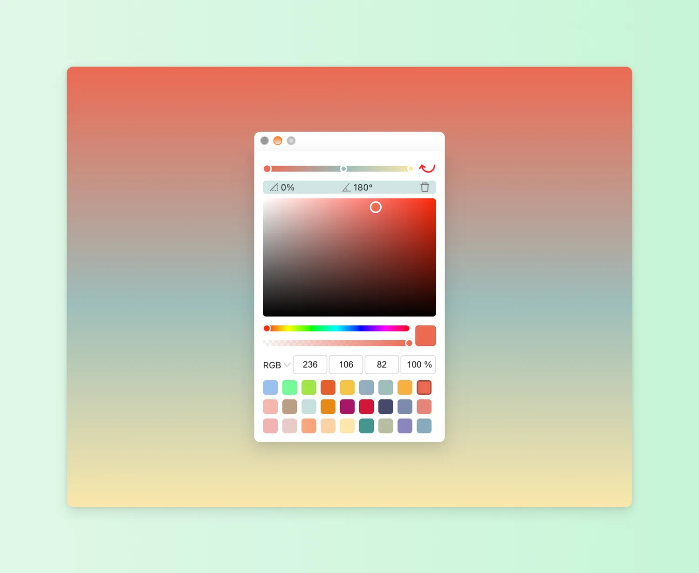
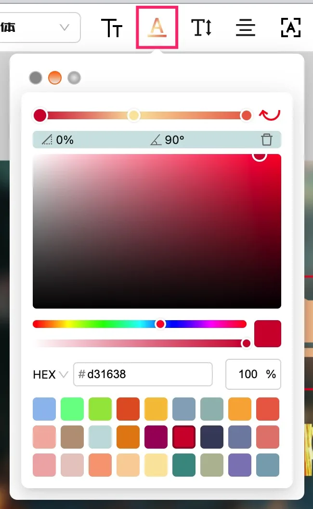
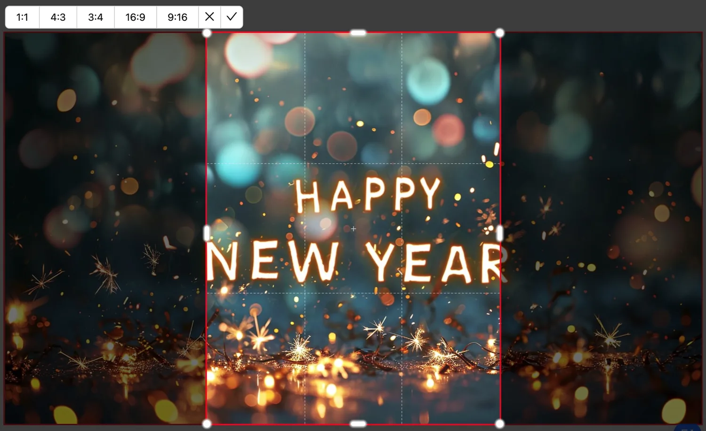

在圣诞节发布 2.0 版本之后，fabritor 就进入了下一个迭代，终于在 2024 年元旦，next 分支合并进主干，发布 2.1 版本，也算是和我的项目一起跨年了。

2.1 版本主要在文本和图片带来一些增强，一些创意的增强。（都在下面的主图里了！

## 颜色渐变

首要支持的便是颜色渐变。fabricjs 虽然支持[渐变](http://fabricjs.com/docs/fabric.Gradient.html)，但怎么配置确实一个难题，属实难找到一个好用的支持渐变的颜色选择器。

所以自己动手开发了 [react-colors-beauty](https://github.com/sleepy-zone/react-colors)，UI 上参考了 sketch 填充选择器，同时支持纯色和渐变色的选择器，文档地址：[https://sleepy-zone.github.io/react-colors/](https://sleepy-zone.github.io/react-colors/)

在文字颜色、文字边框、形状背景、画板背景都支持了渐变配置。

（同时，支持渐变的图标，也以渐变展示。

## 文字图片填充

fabricjs 对象的 fill 属性是支持 pattern 的，也就是图片填充，这也算是对渐变的一种补充。这样可以实现渐变难以实现的效果。

主图里 Happy New Year 的英文就是使用一张烟花图片渐变产生的。

填充图片：

## 图片裁剪

图片新增裁剪功能，在图片工具栏点击裁剪后，就会将当前图片选中，进行自由裁剪。

## 图片滤镜

在 2.0 版本中，我提到重写了图片对象，就是为了便利的享受 fabricjs 内置的滤镜。

这里内置了几个滤镜。（不知道翻译的好不好！

## 写在后面

至此，fabritor 作为一个图片编辑器，功能基本完善了。后续的方向一个是更像一个产品去维护它，更好的操作体验。另外抽出一个快速安装包，以便开发者更简单的部署一个自己的版本。

2024，一起加油吧！
