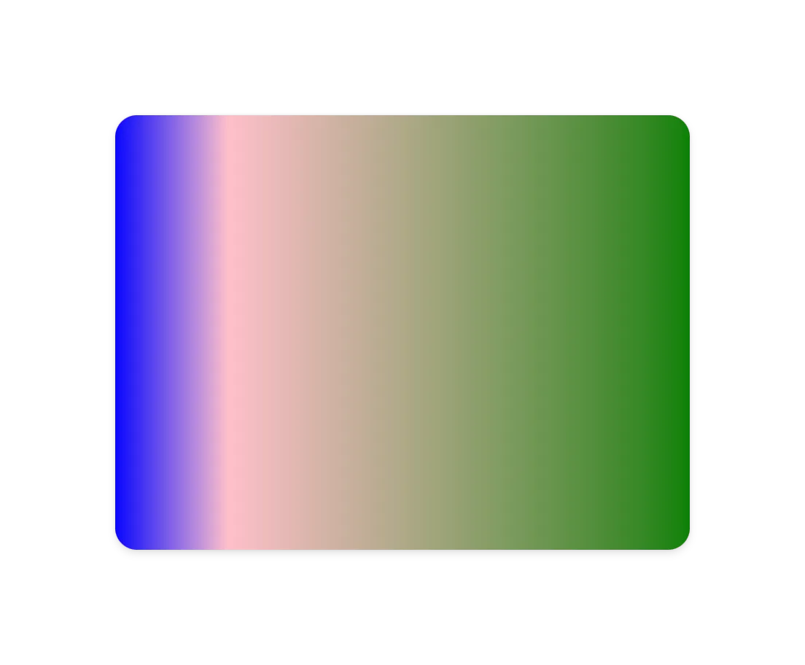
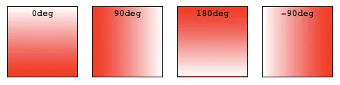
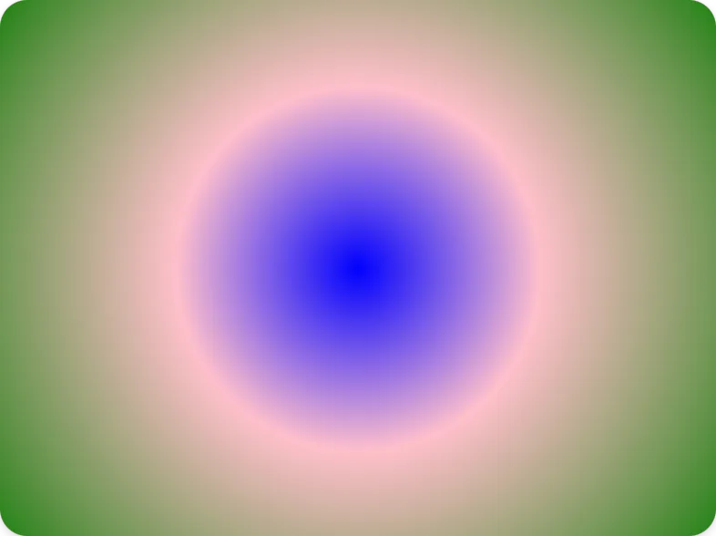
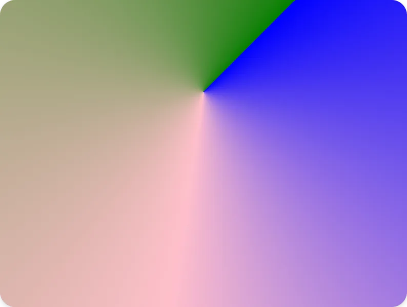
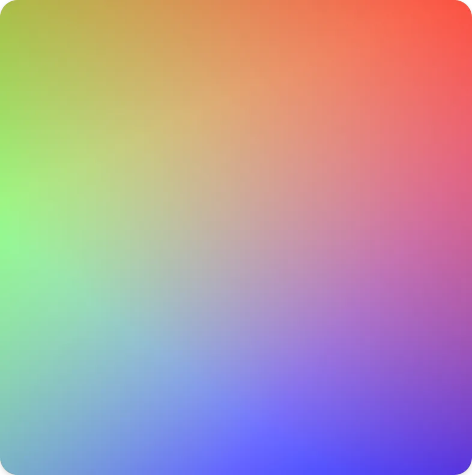
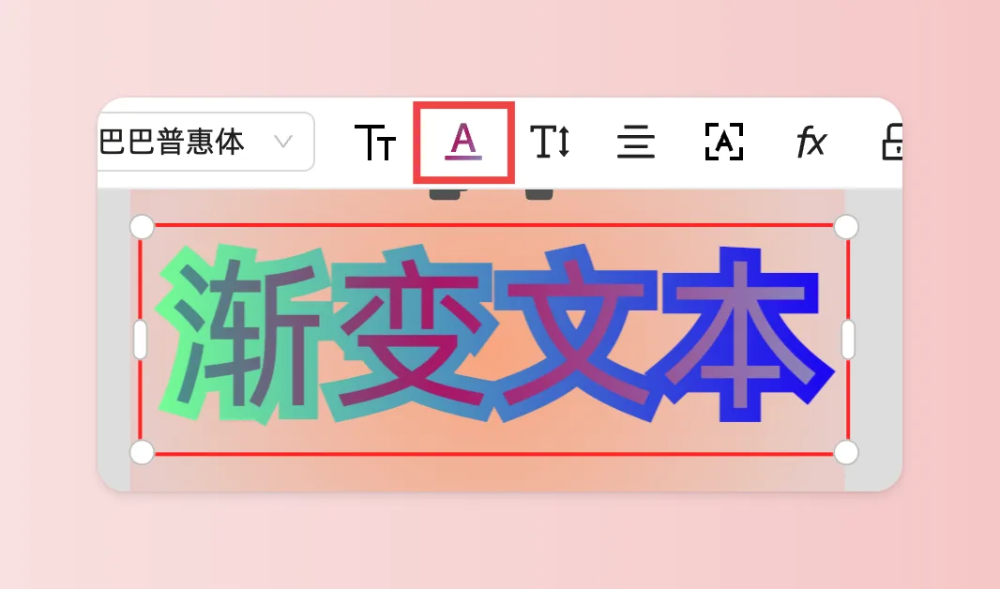
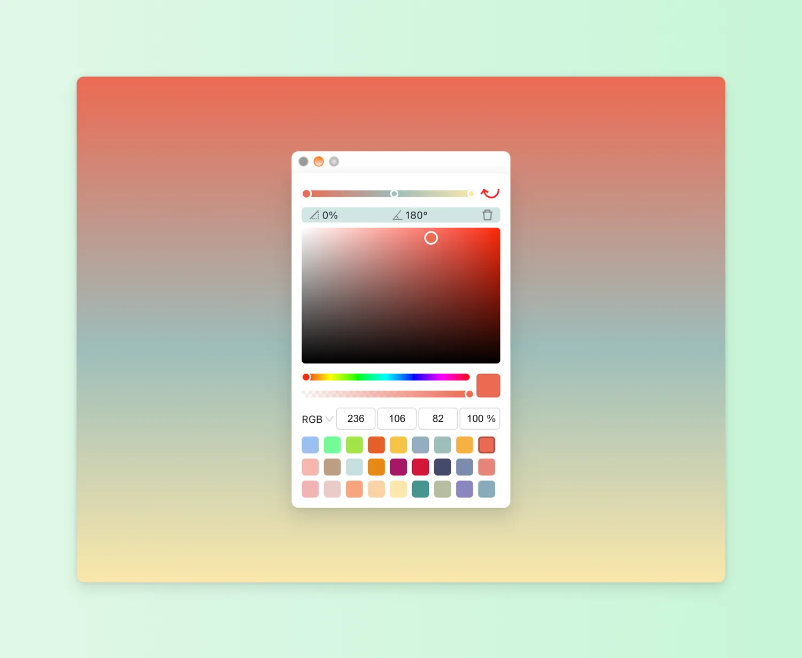

[fabritor](https://github.com/sleepy-zone/fabritor-web) 在最新版本支持了渐变色填充，可以让文字或背景实现更华丽的效果。在实践过程中发现渐变其实是一件挺有意思（很炫酷）的事情，接下来就展开聊聊前端里关于渐变的那些事。

## CSS 渐变

作为前端，说到渐变，最先想到的就是 CSS 渐变了。不过印象中很少手写，一般切页面的时候也很少有这种效果，有也是直接复制 Sketch 导出的 CSS 🤪。

CSS 里的渐变有三类：线性渐变、径向渐变和锥形渐变。直接给丢一段语法和 DEMO 可能有点摸不着头脑。我们可以先看一下维基百科给出的渐变定义：

> 颜色渐变（有时也叫颜色带）是指一定范围的随之位置而变的颜色，通常用于填充某一个区域。渐变产生的颜色随位置连续变化，产生平滑的颜色过渡。

从概念上看，渐变主要由以下内容组成：
1. 随位置变化的颜色，也叫做色标(color stop)。色标由两部分组成，一个是颜色，一个是颜色所在位置。如：`blue 20%` 或者 `blue 20px`。
2. 需要渐变色填充的区域，确定渐变的起点和终点，也就是色标前进的方向。

不论是哪种渐变，都是配置以上两部分，通常语法就是 `xx-gradient(direction, color stop, color stop ...)`。而各类渐变色标部分其实是一致的，那就只要区分确定渐变方向的参数就行了。

### 线性渐变

比如线性渐变，顾名思义，色标沿着一条直线前进。渐变方向是一条直线，就直接用角度确定渐变方向。

```css
.linear {
  background: linear-gradient(90deg, blue 0, pink 20%, green 100%);
}
```

上面代码定义了线性渐变，色标以 90deg 方向（从左到右）前进，依次从蓝色、粉色、绿色渐变，并且定义了每个颜色的位置。

效果如图：



> 在使用角度的时候，0deg 代表渐变方向为从下到上，90deg 代表渐变方向为从左到右，诸如此类正角度都属于顺时针方向。而负角度意味着逆时针方向。



前往 [MDN](https://developer.mozilla.org/zh-CN/docs/Web/CSS/CSS_Images/Using_CSS_gradients#%E4%BD%BF%E7%94%A8%E7%BA%BF%E6%80%A7%E6%B8%90%E5%8F%98) 了解更多关于线性渐变的知识。

### 径向渐变

径向渐变，色标以圆或者椭圆前进。要确定渐变方向，只需要确定圆或者椭圆的的中心即可。

```css
.radial {
  background: radial-gradient(circle at 50% 50%, blue 0, pink 40%, green 100%);
}
```

上面代码定义了径向渐变，圆心在元素的中心。



前往 [MDN](https://developer.mozilla.org/zh-CN/docs/Web/CSS/CSS_Images/Using_CSS_gradients#%E4%BD%BF%E7%94%A8%E5%BE%84%E5%90%91%E6%B8%90%E5%8F%98) 了解更多关于径向渐变的知识。

### 锥形渐变

锥形渐变，色标围绕着中心点旋转，每个色标的区域类似一个扇形。和径向渐变一样，需要确定一个中心点。另外，因为是围绕着中心点旋转，还需要确定一个其实旋转角度。

```css
.conic {
  background: conic-gradient(
    from 45deg at 50% 30%,
    blue 0,
    pink 40%,
    green 100%
  );
}
```

上面代码定义了锥形渐变，中心在元素的 50% 30% 处，从 45deg 开始旋转。



前往 [MDN](https://developer.mozilla.org/zh-CN/docs/Web/CSS/CSS_Images/Using_CSS_gradients#%E4%BD%BF%E7%94%A8%E9%94%A5%E5%BD%A2%E6%B8%90%E5%8F%98) 了解更多关于锥锥形渐变的知识。

### 更多

CSS 渐变除了单一的设置渐变，还支持更高级的渐变设置，比如可以将多个渐变堆叠起来：

```css
.stacked-linear {
  background: linear-gradient(
      217deg,
      rgba(255, 0, 0, 0.8),
      rgba(255, 0, 0, 0) 70.71%
    ), linear-gradient(127deg, rgba(0, 255, 0, 0.8), rgba(0, 255, 0, 0) 70.71%),
    linear-gradient(336deg, rgba(0, 0, 255, 0.8), rgba(0, 0, 255, 0) 70.71%);
}
```




更多效果可以前往 [MDN](https://developer.mozilla.org/zh-CN/docs/Web/CSS/CSS_Images/Using_CSS_gradients#%E4%BD%BF%E7%94%A8%E9%87%8D%E5%A4%8D%E6%B8%90%E5%8F%98) 查看。

CSS 渐变的能力十分强大，关键看有没有创意了。🤔

## Canvas 渐变

canvas 也是支持渐变色的，支持线性渐变和径向渐变。

### Canvas 

线性渐变 `createLinearGradient(x1, y1, x2, y2)`，和 CSS 线性渐变使用角度确定方向不同，四个参数分别表示渐变的起点 (x1,y1) 与终点 (x2,y2)。

```js
const lineargradient = ctx.createLinearGradient(0, 0, 150, 150);
```

径向渐变 `createRadialGradient(x1, y1, r1, x2, y2, r2)`，六个参数分别确定渐变的内圆坐标（x1,y1），内圆半径（r1）以及外圆坐标（x2,y2），外圆半径（r2）。

```js
const radialgradient = ctx.createRadialGradient(75, 75, 0, 75, 75, 100);
```

确定渐变区域和方向后，就可以给渐变添加色标了：

```js
lineargradient.addColorStop(0, "white");
lineargradient.addColorStop(1, "black");
```

### fabric.js 

[fabritor](https://github.com/sleepy-zone/fabritor-web) 内的渐变基于 [fabric.js](http://fabricjs.com/docs/fabric.Gradient.html) 实现。

fabric.js 的渐变也就是封装了 Canvas 渐变 API，源码位置[https://github.com/fabricjs/fabric.js/blob/5.x/src/gradient.class.js](https://github.com/fabricjs/fabric.js/blob/5.x/src/gradient.class.js)：

```js
// 代码片段
var gradient;

if (this.type === 'linear') {
  gradient = ctx.createLinearGradient(
    coords.x1, coords.y1, coords.x2, coords.y2);
}
else if (this.type === 'radial') {
  gradient = ctx.createRadialGradient(
    coords.x1, coords.y1, coords.r1, coords.x2, coords.y2, coords.r2);
}

for (i = 0, len = this.colorStops.length; i < len; i++) {
  var color = this.colorStops[i].color,
      opacity = this.colorStops[i].opacity,
      offset = this.colorStops[i].offset;
  }
  gradient.addColorStop(offset, color);
}

return gradient;
```

canvas 的渐变色同时支持赋值给 stroke 和 fill 属性：


## CSS 文字渐变

不知道你发现了没有，canvas 内是用 `fill` 属性表示填充，所以不论是形状还是文字，都可以应用渐变色。而 CSS 渐变一般我们用在 `background` 或者 `background-image` 属性内，也就是一般用到背景内，文字颜色是用 color 属性设置的，我尝试给 color 属性设置渐变，并不会生效。

那 CSS 要给文字设置渐变色，要怎么做呢？

这里看到一篇文章，[How to add a gradient overlay to text with CSS](https://fossheim.io/writing/posts/css-text-gradient/)，里面给了一种设置文字渐变色的方法。

```css
background-size: 100%;
background-repeat: repeat;
background-clip: text;
color: transparent;
background-image: linear-gradient(45deg, #f3ec78, #af4261);
```

关键属性就是 `background-clip`，设置为 `text`，将背景裁剪成文字的前景色，这里我们又将文字设置为透明，文字就展示为渐变色了。


作者后面还给出几个更加炫酷的案例，可以前往原文查看。

<iframe height="300" style="width:100%" scrolling="no" title="Gradient Text Overlay" src="https://codepen.io/fossheim/embed/wvBYEgY?default-tab=css%2Cresult" frameborder="no" loading="lazy" allowtransparency="true" allowfullscreen="true">
  See the Pen <a href="https://codepen.io/fossheim/pen/wvBYEgY">
  Gradient Text Overlay</a> by Sarah Fossheim (<a href="https://codepen.io/fossheim">@fossheim</a>)
  on <a href="https://codepen.io">CodePen</a>.
</iframe>

## SVG 渐变

SVG 现在用的越来越多了，大多数图标库都直接提供 SVG 图标了。那如何在 SVG 实现渐变呢，首先想到的就是 SVG 是有 fill 属性的，但很遗憾，直接给fill 属性设置 CSS 渐变也是不生效的，SVG 有自己的渐变语法。

SVG 设置渐变首先需要一段渐变 SVG😂：

```html
<svg style="width:0;height:0;position:absolute;" aria-hidden="true" focusable="false">
  <linearGradient id="my-cool-gradient" x1="0" y1="0" x2="1" y2="1">
    <stop offset="0%" stop-color="#447799" />
    <stop offset="50%" stop-color="#224488" />
    <stop offset="100%" stop-color="#112266" />
  </linearGradient>
</svg>
```

你会发现，除了语法不一样，和 canvas 里简直是一一对应的。

这时候将 linearGradient 标签对应的 id 赋值给 svg fill 属性即可。

可以 css 设置：
```css
.icon-sprite-gradient {
  fill: url(sprite.svg#my-cool-gradient) red;
}
```

也可以直接内联 fill 属性设置：

```html
<svg class="icon" fill="url(#my-cool-gradient) #447799;" aria-hidden="true" focusable="false">
  <use xlink:href="#symbol-id"></use>
</svg>
```

径向渐变语法也和 canvas 一致，这里不再展开，依然可以去 [MDN](https://developer.mozilla.org/zh-CN/docs/Web/SVG/Tutorial/Gradients) 查看。

如果你体验过 fabritor，你会发现，文字设置渐变色之后，工具栏的图标也跟随展示为渐变色，就是是用了上述方式实现的。



另外 fabric.js 里，渐变类有个 [`toSVG`](https://github.com/fabricjs/fabric.js/blob/5.x/src/gradient.class.js#L220) 的方法，将 canvas 渐变转换为 svg 渐变。

## 渐变色选择器：react colors beauty

最后，推荐一下我开发的渐变色选择器 [https://github.com/sleepy-zone/react-colors](https://github.com/sleepy-zone/react-colors)，同时支持纯色和渐变色选择（支持色标、线性渐变角度配置），已经在 fabritor 上使用了！



如果你的项目也需要一个渐变色选择器，不妨试一下！
