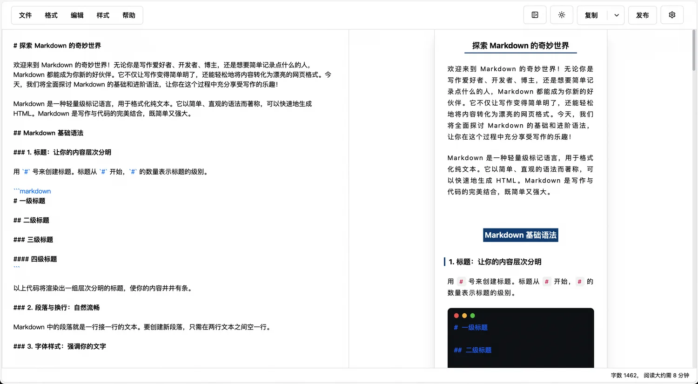
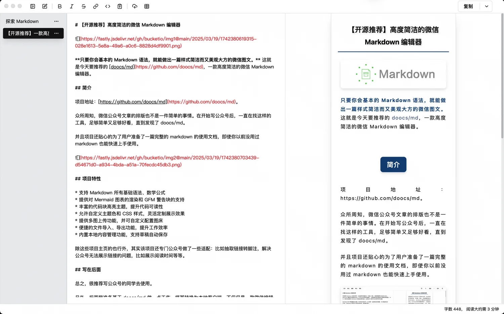

**只要你会基本的 Markdown 语法，就能做出一篇样式简洁而又美观大方的微信图文。** 这就是今天要推荐的 [doocs/md](https://github.com/doocs/md)，一款高度简洁的微信 Markdown 编辑器。

## 简介

项目地址：[https://github.com/doocs/md](https://github.com/doocs/md)。

众所周知，微信公众号文章的排版也不是一件简单的事情。在开始写公众号后，一直在找这样的工具，足够简单又足够好看，直到发现了 doocs/md。

并且项目还贴心的为了用户准备了一篇完整的 markdown 的使用文档，即使你以前没用过 markdown 也能快速上手使用。

## 项目特性

* 支持 Markdown 所有基础语法、数学公式
* 提供对 Mermaid 图表的渲染和 GFM 警告块的支持
* 丰富的代码块高亮主题，提升代码可读性
* 允许自定义主题色和 CSS 样式，灵活定制展示效果
* 提供多图上传功能，并可自定义配置图床
* 便捷的文件导入、导出功能，提升工作效率
* 内置本地内容管理功能，支持草稿自动保存

除这些项目主页的也行外，其实该项目还专门公众号做了一些适配：比如抽取链接转脚注，解决公众号无法展示链接的问题，比如展示阅读时间等等。

## 写在后面

总之，很推荐写公众号的同学去使用。

另外，后面我准备基于 doocs/md 做一点工作，将其转换为本地客户端，不仅仅是一款微信编辑器，更是一款简单的本地知识库管理工具。

目前正在开发中：https://github.com/sleepy-zone/woocs，欢迎关注。本文已经用 woocs 编写了！

