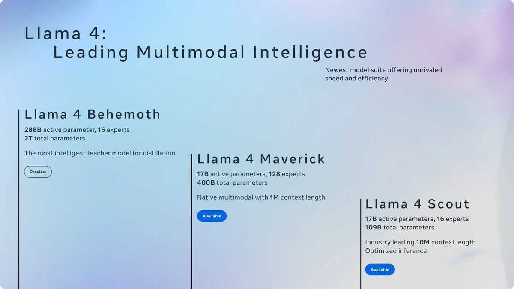

AI 公司貌似喜欢在中国的节假日搞动作，清明节短短三天假期就有很多猛料。

### Github 官方 MCP Server 发布

github 博客链接：https://github.blog/changelog/2025-04-04-github-mcp-server-public-preview/

官方仓库：https://github.com/github/github-mcp-server

> 今天，我们发布了一款新的开源官方本地 GitHub MCP 服务器。我们与 Anthropic 合作，用 Go 重写了他们的参考服务器，并提高了其可用性。新服务器包含旧服务器的 100% 功能，此外还能够自定义工具描述、支持代码扫描，并新增了 get_me 函数，该函数可改善自然语言用户体验，例如询问“显示我的私人存储库”。

今天又看到一则消息，后面的模型将不再支持 Tool。还是那句话，持续看好 MCP！

### Meta Llama 4 发布

Meta Llama 4 发布，号称最强模型。

不过社区评价看起来好像不怎么好，虽然有超大的上下文窗口，但体验一般，知乎的讨论也是一边倒的看衰：https://www.zhihu.com/question/1892067881098903620

另外，Qwen、DeepSeek R2 据说也快发布了，还是期待国内的模型吧。

### OpenRouter 发布 Quasar Alpha

OpenRouter（https://openrouter.ai/），是一个模型服务商，他们也发布了自家模型，上下文达到 1m，特别适合代码，并且免费！

> This is a cloaked model provided to the community to gather feedback. It’s a powerful, all-purpose model supporting long-context tasks, including code generation. All prompts and completions for this model are logged by the provider as well as OpenRouter.

> 这是提供给社区以收集反馈的隐藏模型。这是一个功能强大的通用模型，支持长上下文任务，包括代码生成。此模型的所有提示和完成都由提供商和 OpenRouter 记录。
