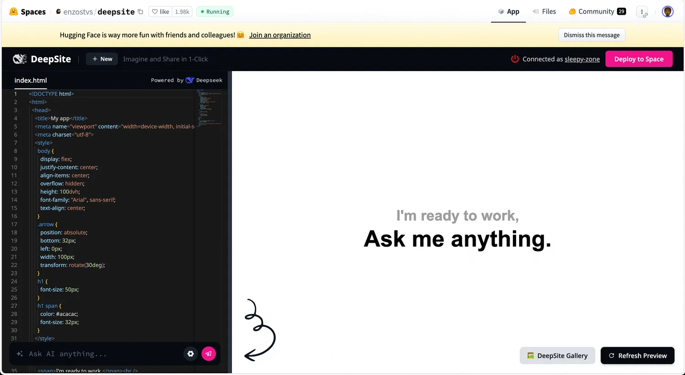
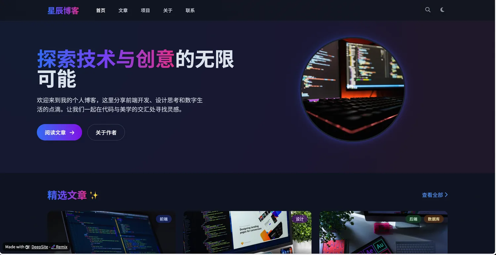
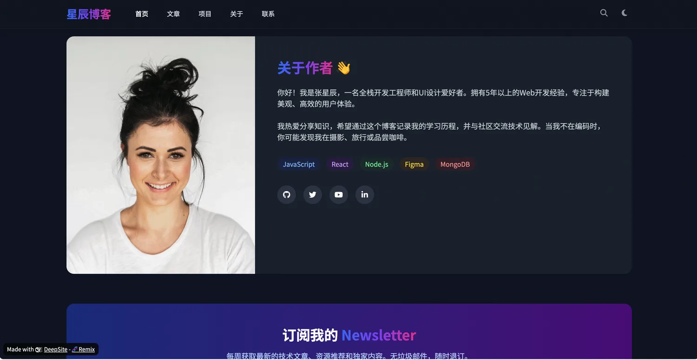

## 试用一下

最近看到很多人都在聊一个 DeepSite 的应用，应用部署在 huggingface：[https://huggingface.co/spaces/enzostvs/deepsite](https://huggingface.co/spaces/enzostvs/deepsite)，功能很简单直接：**基于 DeepSeek 一键生成纯 html 应用并且可以发布至 huggingface space**。

我试了一下，让 DeepSite 生成一个炫酷的个人博客首页。

整体效果很不错，页面完整，效果炫酷，我已经部署到我的 space ：[https://huggingface.co/spaces/sleepy-zone/sleepyspace](https://huggingface.co/spaces/sleepy-zone/sleepyspace)：





## 看看代码

代码位于：[https://huggingface.co/spaces/enzostvs/deepsite/tree/main](https://huggingface.co/spaces/enzostvs/deepsite/tree/main)。

DeepSeek 生码的逻辑位于 `server.js`：

```js
const chatCompletion = client.chatCompletionStream({
      model: MODEL_ID,
      provider: selectedProvider.id,
      messages: [
        {
          role: "system",
          content: `ONLY USE HTML, CSS AND JAVASCRIPT. If you want to use ICON make sure to import the library first. Try to create the best UI possible by using only HTML, CSS and JAVASCRIPT. Use as much as you can TailwindCSS for the CSS, if you can't do something with TailwindCSS, then use custom CSS (make sure to import <script src="https://cdn.tailwindcss.com"></script> in the head). Also, try to ellaborate as much as you can, to create something unique. ALWAYS GIVE THE RESPONSE INTO A SINGLE HTML FILE`,
        },
        ...(previousPrompt
          ? [
              {
                role: "user",
                content: previousPrompt,
              },
            ]
          : []),
        ...(html
          ? [
              {
                role: "assistant",
                content: `The current code is: ${html}.`,
              },
            ]
          : []),
        {
          role: "user",
          content: prompt,
        },
      ],
      ...(selectedProvider.id !== "sambanova"
        ? {
            max_tokens: selectedProvider.max_tokens,
          }
        : {}),
    });
```

prompt 也很简洁：仅使用 HTML、CSS 和 JavaScript。如果您想使用图标，请确保首先导入库。尽量仅使用 HTML、CSS 和 JavaScript 创建最好的 UI。尽可能多地使用 TailwindCSS 进行样式设计，如果无法使用 TailwindCSS 完成某些样式，则使用自定义 CSS（确保在中导入 <script src="https://cdn.tailwindcss.com"></script>）。此外，尽量详细 elaboration，以创建一些独特的东西。始终将响应提供为单个 HTML 文件。

其他都是前端代码，目前看自己部署一个成本也不是很高。喜欢折腾的朋友可以玩一下看。

---

**最后感叹一下，现在模型的能力突飞猛进。而模型能力跟上之后，应用的创意和交互体验就显得尤为重要。**
