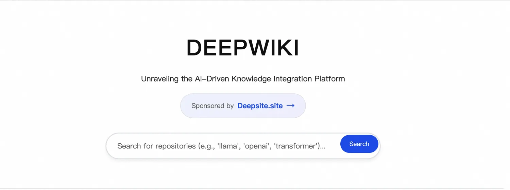
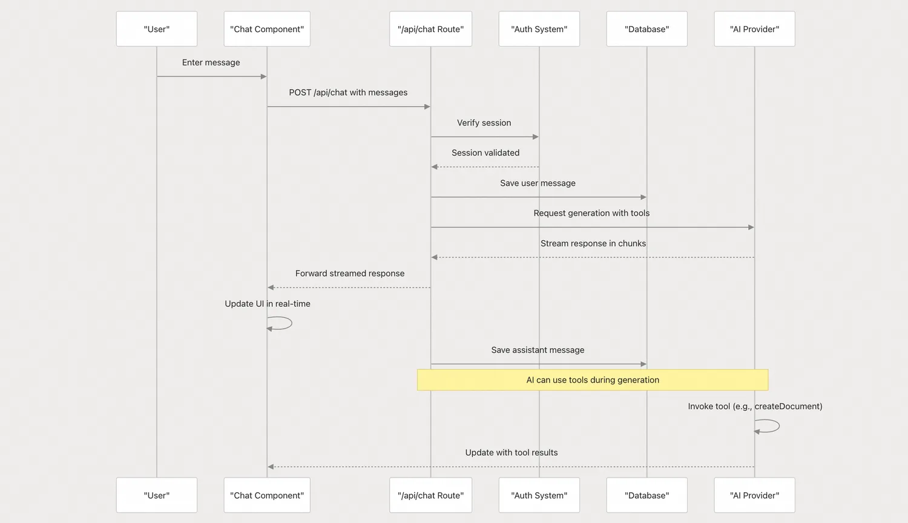

以后推荐开源项目：
❌ https://github.com/xx/yy
✅ https://deepwiki.com/xx/yy

---

Devin （就是那个每月 500 刀的 AI 程序员）团队推出了 DeepWiki（https://deepwiki.org/），从此阅读源码更方便了。

只需要将开源项目链接的 github.com 替换为 deepwiki.com，就可以得到一份详尽的项目文档，比如：https://deepwiki.com/vercel/ai-chatbot。

（比源文档详细的多：https://chat-sdk.dev/docs/getting-started/overview）

甚至文档内还有图表：

并且可以基于文档进行问答：

快去试试吧！

最后祝大家五一假期快乐！
