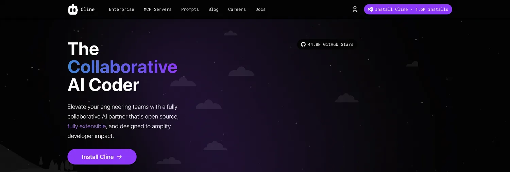
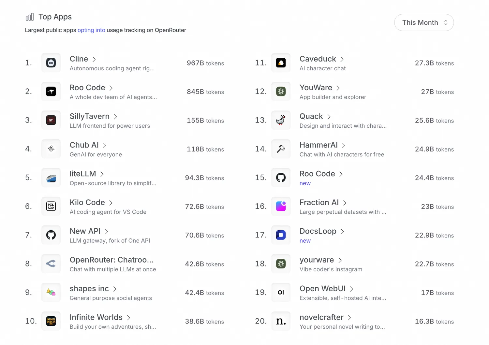
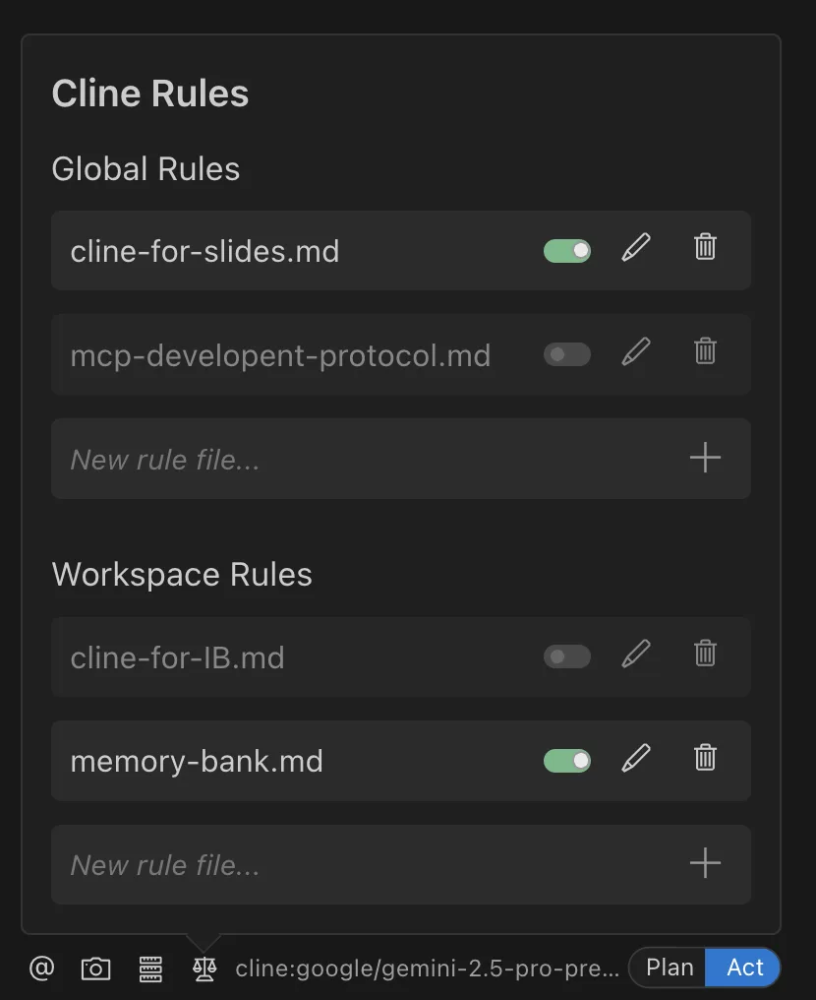

### 写在前面

最近在业务（面向用户的 C 端业务）中较多的使用了 [Cline](https://docs.cline.bot/getting-started/what-is-cline)，总体感觉非常丝滑（尤其是看着他在默默地生成代码并且自己排查错误的时候，但 Token 确实也消耗的很快😂）。

Cline 算是 VS Code AI 开发插件中的佼佼者了，并且是一个开源项目，他的一个 fork 分支 RooCode 热度也很高。



### 开始配置 Cline Rules

作为一个通用的编程助手，如何能针对不同的项目进行更好的开发，除了 Cline 本身对代码的理解之外，作为用户如果能提供更多的指引，可以让 Cline 发挥更好的作用。

一般来说，Cline、Cursor 及其他代码 Agent 都会提供 rules 这个概念，在项目根目录下新建 rules 目录，目录下根据自己的项目可以新建各种规则文件。

```markdown
your-project/
	├── .clinerules
		├── project.md
        ├── api.md
	├── src/
	├── docs/
	└── ...
```

如果你的规则全局通用，可以将规则放置到 `Documents/Cline/Rules` 目录。

### Cline Rules 优势

放在项目内好处很明显：
1. 可以针对每个项目配置不同的规则；
2. 作为项目源代码的一部分，进行版本控制，持续维护，跟随项目发展设置长远的 rule；
3. 保证团队成员使用 AI 的行为是一致的。

### Cline Rules 的原则

1. 清晰简洁：使用简单语言，避免歧义。
2. 关注期望结果：描述你想要的结果，而不是具体步骤。
3. 测试和迭代：试验找出最适合你的工作流程的方法。

rules 本质上是自定义 prompts，和 Cline 的 system prompts 互为补充，共同为项目服务。（system promps：https://github.com/cline/cline/blob/main/src/core/prompts/model_prompts/claude4.ts）

关于提示词，我之前有总结过[谷歌的提示词最佳实践](https://mp.weixin.qq.com/s/YFV0MO_pX3Us-PEMzxF0vQ)，可以看一下。

### 高级用法 Rules Bank

Rules Bank 顾名思义，就是存放 Rules 的地方，如果你的项目很复杂，又有前端、又有后端、又有不同的技术栈，这个时候就很有用。

```markdown
your-project/
├── .clinerules/              # Active rules - automatically applied
│   ├── 01-coding.md
│   └── client-a.md
│
├── clinerules-bank/          # Repository of available but inactive rules
│   ├── clients/              # Client-specific rule sets
│   │   ├── client-a.md
│   │   └── client-b.md
│   ├── frameworks/           # Framework-specific rules
│   │   ├── react.md
│   │   └── vue.md
│   └── project-types/        # Project type standards
│       ├── api-service.md
│       └── frontend-app.md
└── ...
```

比如当你在开发 React 技术栈的时候，从 Rules Bank 中复制 React Rule 到 Cline Rules 内。

```bash
# Switch to React
rm .clinerules/vue.md
cp clinerules-bank/clients/react.md .clinerules/
```

总之一切文本放到代码仓库中，提高可持续性，并且可以跟随项目保持最新的迭代！

### 如何管理

Cline 提供了一种方便的方式管理 Rules，在输入框下方一个天平的小标志内，可以打开 Rule 管理器，新增删除或者启用禁用 Rule。



### 最后

十分建议你在平时工作中使用 Cline，并使用 Cline Rule 增强开发体验。后面会持续更新 Cline 的相关内容。

最后，假期快乐！
